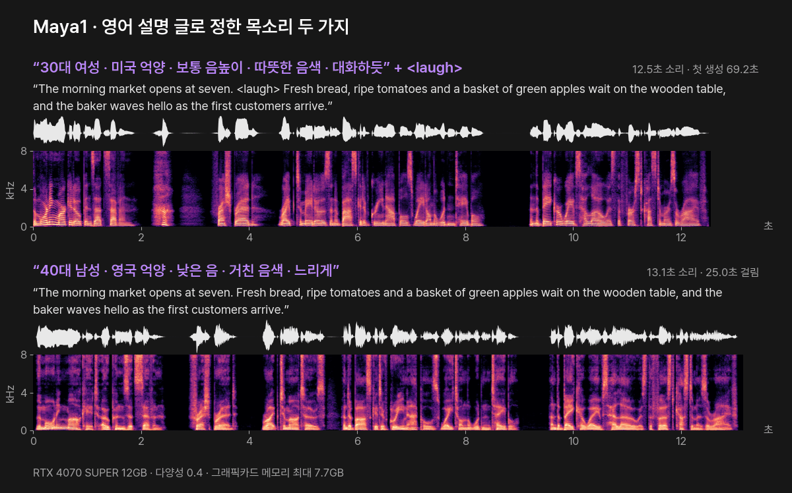
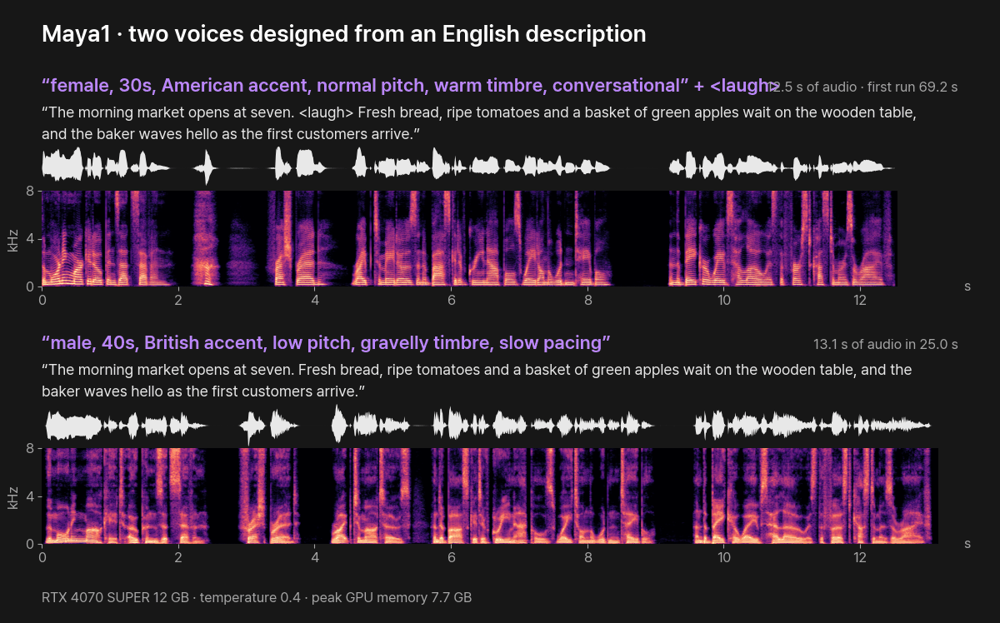

# Maya1 — 글로 목소리 설계 · 감정 태그 (PromBoard 플러그인)

[English](#english)

글을 읽어 목소리(WAV)로 만드는 PromBoard 커뮤니티 플러그인입니다. maya-research 의 오픈 모델 [Maya1](https://huggingface.co/maya-research/maya1)(3.3B)을 이 PC 에서 돌립니다. 목소리는 영어 설명 글(성별 · 나이 · 억양 · 음높이 · 음색 · 말투)로 정하고, 읽을 글 안에 `<laugh>` · `<sigh>` · `<whisper>` 같은 감정 태그를 넣어 그 자리를 그렇게 읽게 합니다. 모델은 Apache-2.0 이라 상업에도 쓸 수 있습니다.



목소리 설명 글만 바꿔 같은 글을 읽혔습니다. 위 글에는 `<laugh>` 태그를 넣었고, 그 자리(2~3초)는 말이 아닌 소리로 채워졌습니다(받아쓰기에 글자가 나오지 않음). 각 소리의 위 띠는 파형, 아래 띠는 스펙트로그램(가로 = 시간, 세로 = 소리 높낮이, 밝을수록 큰 소리)입니다. 듣기: [30대 미국 여성](docs/ko/audio/female-us.mp3?raw=true) · [40대 영국 남성](docs/ko/audio/male-uk.mp3?raw=true)

- 플러그인 id: `promboard.maya1`
- 필요한 앱: PromBoard 1.0.2 이상
- 지원 언어: 영어. **한국어는 없습니다**(공식 카드에 언어 목록이 없고 영어 예시만 있습니다). 목소리 복제도 없습니다.
- 라이선스: 플러그인 코드 · 모델 Apache-2.0

## 받는 것과 용량

| 무엇 | 출처 | 크기 | 라이선스 |
|---|---|---|---|
| Maya1 (Llama 구조 3.3B, bf16) | [maya-research/maya1](https://huggingface.co/maya-research/maya1) | 6.63GB | Apache-2.0 |
| SNAC 24kHz 소리 디코더 | [hubertsiuzdak/snac_24khz](https://huggingface.co/hubertsiuzdak/snac_24khz) | 79MB | MIT |
| 파이썬 패키지(PyTorch 2.8 · transformers · snac 등) | PyPI · PyTorch | 약 3GB(다른 플러그인과 같은 PyTorch 는 다시 받지 않습니다) | 각 패키지 |

## 필요한 그래픽카드 메모리

실측 최대 7.7GB(파이토치가 잡은 양, 그래픽카드 준비분 0.4GB 별도)입니다. 8GB 그래픽카드는 모자랄 수 있어 플러그인 최소 요구를 9GB 로 적었습니다. CPU 로는 돌리지 않습니다(3.3B 모델이라 너무 느립니다).

## 쓰는 법

노드 추가 목록에서 「Maya1 목소리」를 놓고 글 노드(영어)를 '읽을 글'에 이은 뒤 ▷ 를 누릅니다.

| 설정 | 뜻 |
|---|---|
| 목소리 설명 (영어) | 성별 · 나이 · 억양 · 음높이 · 음색 · 말투를 영어로 적습니다. 예: `Realistic male voice in the 40s age with british accent. Low pitch, gravelly timbre, slow pacing.` |
| 다양성 (temperature) | 낮으면 안정적으로, 높으면 다채롭게 읽습니다. 공식 예제는 0.4, 모델 기본 설정은 0.6 입니다 |

감정 태그 17가지(공식 `emotions.txt`): `<laugh>` `<laugh_harder>` `<sigh>` `<chuckle>` `<gasp>` `<angry>` `<excited>` `<whisper>` `<cry>` `<scream>` `<sing>` `<snort>` `<exhale>` `<gulp>` `<giggle>` `<sarcastic>` `<curious>`

- 한 번에 3,000자(약 3분 분량)까지 받습니다. 소리 길이의 두 배쯤 걸려서, 앱이 노드 한 번에 주는 시간(만들기 15분) 안에 끝나게 정했습니다. 공식 카드가 긴 글은 알맞은 길이로 나눠 만들라고 해서, 문장 경계에서 280자 안쪽으로 나눠 같은 설명으로 차례로 만들고 0.15초 쉼을 두고 잇습니다. 복제가 없는 모델이라 조각 사이에 목소리가 조금 달라질 수 있습니다.
- 생성 설정은 공식 카드 예제 그대로입니다(top_p 0.9 · repetition_penalty 1.1 · 조각마다 최대 2,048 토큰).

## 실측

PromBoard 앱에서 실제로 돌려 쟀습니다(앱 1.0.3-beta 의 실행 경로 그대로, RTX 4070 SUPER 12GB · i7-14700K · Windows 11). 만든 소리를 Whisper large-v3-turbo 로 다시 받아써 원문과 비교했습니다.

| 경우 | 글 | 만든 소리 | 걸린 시간 | 그래픽카드 메모리 최대 | 받아쓰기 비교 |
|---|---|---|---|---|---|
| 30대 미국 여성 + `<laugh>` (첫 생성) | 181자 | 12.5초 | 69.2초 | 7.3GB | 글과 같음 |
| 40대 영국 남성 | 173자 | 13.1초 | 25.0초 | 7.7GB | 글과 같음 |

- 모델을 올리는 데 113초 걸렸습니다(첫 실행, 이 PC 의 느린 하드디스크 기준). 첫 생성은 그래픽카드 준비가 겹쳐 더 느립니다.
- 소리 토큰을 하나씩 만드는 모델이라 소리 길이의 두 배쯤 걸립니다(이 PC 기준).

## 라이선스와 조건

- 모델: Apache-2.0(공식 카드). SNAC 디코더: MIT.
- 공식 카드 「Responsible deployment」: 합성 목소리임을 알맞게 밝히고, 속이려는 사칭 · 사기 · 조작된 증거 · 실존 인물 발언 흉내에 쓰지 않습니다.

## 파일

```
manifest.json                 플러그인 정보 · 노드 정의 · 받을 모델
icon.png
nodes/main.py                 노드 코드
nodes/requirements.in         직접 쓰는 패키지
nodes/requirements-*.txt      운영체제별 해시 잠금 파일(uv pip compile --generate-hashes, Python 3.12)
docs/                         이 README 의 그림 · 소리(ko · en). 플러그인 zip 에는 넣지 않는다
docs/scripts/                 위 그림 · mp3 를 노드 결과 WAV 로 다시 만드는 스크립트(make_visuals.py)와 그림 설정(hero.json)
```

README 그림 · 소리 다시 만들기: 노드 결과 WAV 를 hero.json 의 `wav` 이름으로 docs/scripts 에 두고 `python docs/scripts/make_visuals.py docs/scripts/hero.json docs ko`(영어판은 `en`)를 실행합니다(numpy · scipy · matplotlib · Pillow · ffmpeg · Pretendard 글꼴).

레지스트리에 올리는 zip 은 PromBoard 앱 저장소의 `server/src/tools/packPlugin.ts` 로 만듭니다. `git archive HEAD` 로 꺼낸 폴더를 넘기면 `.gitattributes` 의 `export-ignore` 로 `docs/` 가 빠집니다.

---

## English

**Maya1 — voice design from text · emotion tags** is a PromBoard community plugin that turns text into speech (WAV) with maya-research's open [Maya1](https://huggingface.co/maya-research/maya1) model (3.3B), running on this PC. You describe the voice in English (gender, age, accent, pitch, timbre, pacing) and put emotion tags such as `<laugh>`, `<sigh>` and `<whisper>` inside the text. The model is Apache-2.0, so commercial use is allowed.



Only the voice description changed. The first text carries a `<laugh>` tag; that spot (2–3 s) is filled with a non-speech sound (no words in the transcription). For each sound the upper strip is the waveform and the lower strip is the spectrogram (time to the right, pitch upward, brighter = louder). Listen: [American woman, 30s](docs/en/audio/female-us.mp3?raw=true) · [British man, 40s](docs/en/audio/male-uk.mp3?raw=true)

- Plugin id: `promboard.maya1`
- Requires PromBoard 1.0.2 or later
- Language: English. **No Korean** (the official card lists no languages and shows English examples only). No voice cloning.
- License: plugin code and model Apache-2.0

### Downloads

| What | Source | Size | License |
|---|---|---|---|
| Maya1 (Llama architecture, 3.3B, bf16) | [maya-research/maya1](https://huggingface.co/maya-research/maya1) | 6.63 GB | Apache-2.0 |
| SNAC 24 kHz audio decoder | [hubertsiuzdak/snac_24khz](https://huggingface.co/hubertsiuzdak/snac_24khz) | 79 MB | MIT |
| Python packages (PyTorch 2.8, transformers, snac, …) | PyPI · PyTorch | about 3 GB (PyTorch shared with other plugins is not downloaded again) | per package |

### GPU memory

Measured peak 7.7 GB (memory reserved by PyTorch, plus about 0.4 GB for the GPU context). An 8 GB card may run short, so the plugin asks for at least 9 GB. It does not run on the CPU (a 3.3B model is too slow there).

### Use

Add the **Maya1 목소리** node, connect an English text node to **읽을 글** (text to read) and press ▷. Settings: **목소리 설명** (voice description, in English) and **다양성** (temperature; the official example uses 0.4, the model's generation config 0.6). The 17 emotion tags from the official `emotions.txt`: `<laugh>` `<laugh_harder>` `<sigh>` `<chuckle>` `<gasp>` `<angry>` `<excited>` `<whisper>` `<cry>` `<scream>` `<sing>` `<snort>` `<exhale>` `<gulp>` `<giggle>` `<sarcastic>` `<curious>`. The setting labels inside the app are in Korean for now (the plugin format takes one language).

Up to 3,000 characters (about 3 minutes of audio): generation takes about twice the audio length, and a run has to finish within the time the app gives one node (15 minutes of generation). The official card recommends generating long text in manageable passages, so the node splits at sentence boundaries into chunks of up to 280 characters, generates each with the same description and joins them with a 0.15 s pause. Without cloning, the voice can drift slightly between chunks. Sampling follows the official card example (top_p 0.9, repetition_penalty 1.1, up to 2,048 tokens per chunk).

### Measured

Measured inside the PromBoard app (the app's own run path, app 1.0.3-beta, RTX 4070 SUPER 12 GB, i7-14700K, Windows 11). Each result was transcribed back with Whisper large-v3-turbo and compared with the input text.

| Case | Text | Audio | Time | Peak GPU memory | Transcription check |
|---|---|---|---|---|---|
| American woman, 30s + `<laugh>` (first run) | 181 chars | 12.5 s | 69.2 s | 7.3 GB | matches the text |
| British man, 40s | 173 chars | 13.1 s | 25.0 s | 7.7 GB | matches the text |

- Loading the model took 113 s (first run, on this PC's slow hard disk). The first generation is slower because the GPU warms up at the same time.
- The model generates audio tokens one by one, so it takes about twice the audio length on this PC.

### License and conditions

- Model: Apache-2.0 (official card). SNAC decoder: MIT.
- Official card, "Responsible deployment": disclose synthetic voice where appropriate, and do not use it for deceptive impersonation, fraud, fabricated evidence or unauthorized representations of a real person's statements.

The `docs/` folder holds the pictures and sounds for this README and is left out of the plugin zip (`git archive HEAD` + `export-ignore`).
